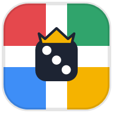
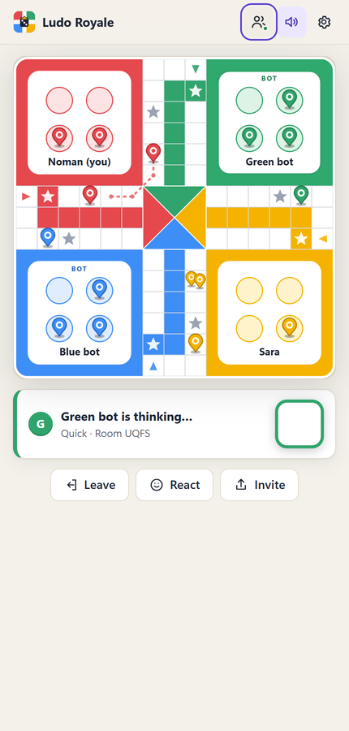
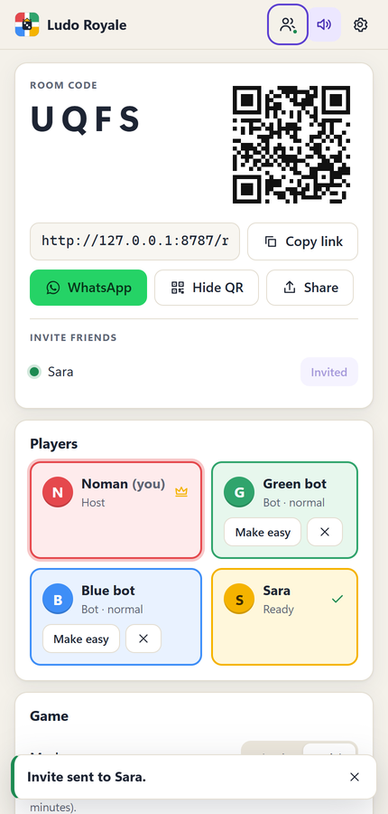
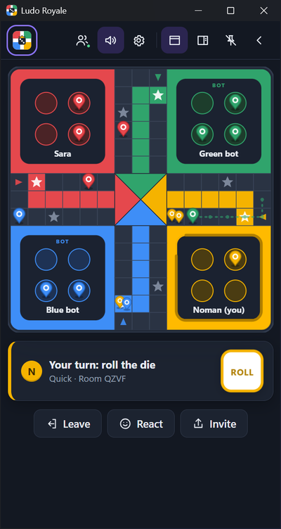

<p align="center"></p>

# Ludo Royale

**Ludo with friends and colleagues, wherever they are.**

Ludo Royale is a small, free online Ludo game. Make a room, send the link to your friends on WhatsApp
(or show them the QR code), and play together from different offices and countries. It runs in any
modern browser, and there's a tiny Windows app that can sit as a side panel next to your work and tells
you when a friend invites you or when it's your turn.

<p align="center">
  
  
  
</p>

## Play

- **In the browser**: open the game's website (the Worker's address, for example
  `https://ludo.nomanshafiq.com` once it's deployed) on a PC, Mac or phone. Nothing to install, no account.
- **On Windows 10 and 11**: install the app below. It's the same game in a window or side panel, plus a
  tray icon and Windows notifications.

### Download (Windows 10 / 11)

| Download | Size | What it is |
|---|---|---|
| [LudoRoyale-Setup-1.0.0.exe](release/LudoRoyale-Setup-1.0.0.exe) | 2.5 MB | Installer for your user account (no administrator rights needed) |
| [LudoRoyale-1.0.0-portable.zip](release/LudoRoyale-1.0.0-portable.zip) | 0.6 MB | Portable copy: unzip anywhere and run `LudoRoyale.exe` |

- The app uses two parts of Windows itself: **.NET Framework 4.8** (built into Windows 10 version 1903 and
  later, and Windows 11) and the **Microsoft Edge WebView2 Runtime** (built into Windows 11 and installed on
  Windows 10 by Windows Update). If one is missing, setup or the app says so and links to Microsoft's
  free download. That's why the download is so small.
- **Windows 7 and 8.1**: the app doesn't run there; play in the browser instead.
- One build runs natively on 64-bit, 32-bit and ARM64 Windows. Tested on Windows 11 x64; not yet tried
  on ARM64 hardware or 32-bit Windows 10.
- The files aren't code-signed, so Windows SmartScreen may say *"Windows protected your PC"*. Click
  **More info › Run anyway**.
- SHA-256 checksums are in [release/SHA256SUMS.txt](release/SHA256SUMS.txt). To check a download, run
  `Get-FileHash .\LudoRoyale-Setup-1.0.0.exe` in PowerShell and compare.

## How to play

1. Pick a nickname, then **Create a room**. Share the link, the 4-letter code, WhatsApp, or the QR code.
2. In the lobby everyone picks a colour. The host can fill empty seats with bots (easy or normal),
   choose **Classic** or **Quick** and **Everyone** or **2 vs 2**, then starts once the others are ready.
3. Rules:
   - Roll a **6** to bring a token out of the yard. A 6 also gives another roll; **three 6s in a row** lose
     the turn.
   - Landing on an opponent sends it back to its yard and gives you another roll.
   - The **stars** and the coloured **start squares** are safe: nobody is captured there.
   - Go round the board into your coloured home column. You need the **exact** number to reach home,
     and reaching home gives another roll.
   - **Classic**: bring all four tokens home. **Quick**: one token starts on the board and two home win
     (about 10 minutes).
   - **2 vs 2**: opposite corners are partners (red + yellow against green + blue). Partners can't capture
     each other; once your own tokens are home you move your partner's. A team wins when both are home.
4. Each turn has a 20-second timer; if it runs out the game plays a sensible move for you, and after two
   missed turns (or if your connection drops for 30 seconds) a bot takes your seat until you're back.
   Reopen the link to get your seat back.
5. **Keyboard**: Space rolls the die, 1 to 4 move a token. Tokens you can move are highlighted.
6. React with one of eight emoji (there's no text chat). **Play vs computer** works offline.

## Friends and notifications

- Everyone gets a **friend code** like `LUDO-7K3M-Q9P2` (no account, no email). Share it, its link or its
  QR code; friends must accept a request. You can remove or block anyone, and the lobby offers
  **Add friend** for people you just played with.
- The friends list shows who's online. **Invite** sends a friend a notification with a **Join** button.
- In the Windows app, invites, friend requests and "your turn" arrive as Windows notifications from
  Ludo Royale (click one to jump to the room). "Your turn" only pops up while the game is hidden or
  collapsed, and only once until you come back. **Do not disturb** (tray menu or Settings) silences them,
  and nothing pops up while a full-screen app or a presentation is running.
- In the browser you get in-page notifications, and optionally the browser's own notifications while
  the tab is in the background (Settings › Notifications, after the browser asks for permission).

## The Windows app

- **Side panel**: the dock button docks the game to the right or left edge of the screen at full height
  (drag it to the other half of the screen to switch sides, drag its edge to change the width). **Pin**
  keeps it on top, and **collapse** turns it into a slim tab at the edge; click the tab to open the panel
  again (drag it to move it up or down). A red dot on the tab means an invite or your turn came in.
- **Tray icon**: Open, Side panel, Do not disturb, Quit.
- **Closing the window** asks whether to keep Ludo Royale running in the tray (so invites still arrive)
  or quit. You can tick "Remember my choice" and change it later in Settings.
- **Start with Windows** is off unless you switch it on (Settings, or the installer's checkbox); it then
  starts quietly in the tray.
- **Game links**: `ludoroyale://join/ABCD` and `ludoroyale://friend/LUDO-XXXX-XXXX` open the app (the
  website offers "Open this room in the app" on Windows). Only one copy runs; a second start hands its
  link to the running one.
- **Updates**: the app checks `https://www.nomanshafiq.com/updates/ludo-royale.json` about 10 seconds after
  starting and then once a day, offers new versions in a bar (Update now / Later / Skip), downloads the
  installer, checks its size and SHA-256, and installs it silently. The feed doesn't exist yet, so nothing
  happens until it's published.
- Light and dark follow Windows (or pick one in Settings); Windows 11 shows a Mica title bar.

## Privacy and security, simply

- **What the server keeps**: your nickname, your random friend code, a scrambled (SHA-256) copy of your
  secret key, your friends list, open friend requests and blocks. No email, no password, no analytics,
  no ads. IP addresses are only used to count requests for the rate limits and aren't stored by the game
  (request logging in Cloudflare is switched off). A friend code that isn't used for about a year is deleted
  automatically.
- **Rooms** live only while they're used and are deleted two hours after the last move. People in the same
  room see each other's nickname and friend code (that's what makes **Add friend** in the lobby work).
- **No chat**: only eight fixed emoji reactions, and nicknames are checked (length, characters, a small
  list of rude words), so there's nothing to moderate.
- **The server decides everything**: it rolls the dice with a cryptographic random generator and checks
  every move against the rules. Players only send "roll" or "move token 2", so a modified client can't
  cheat.
- **Built to be hard to abuse**: every message is checked against a strict format and size limit, each
  connection is rate-limited, new players and rooms are limited per address, the game only accepts
  connections from its own pages and the Windows app (origin check), and all traffic is HTTPS/WSS.
  The web pages send a strict Content Security Policy.
- **Your secret key** stays on your device: in the browser's storage, or in the app's settings file,
  encrypted for your Windows account.
- **The Windows app** shows the game from files installed with it and never loads web pages from the
  internet; its only connection is to the game server (plus the update feed). It blocks navigation,
  pop-ups, downloads and browser permissions inside the game view, and it opens WhatsApp links in your
  normal browser. It needs no administrator rights, and uninstalling removes its link handler and
  start-up entry.

## Develop

You need Node.js 22+ (tested with 26), and for the Windows app the .NET SDK (any recent one; it builds the
.NET Framework 4.8 app) and Inno Setup 6.

```powershell
npm install
npm run dev            # builds the web client and starts the game server on http://127.0.0.1:8787
npm test               # rules engine, protocol and client tests (fast)
npm run test:integration  # starts wrangler dev and plays real games over WebSockets (about 90 s)
npm run typecheck
npm run e2e            # two headless Edge players: friends, invite, lobby, a full game (needs npm run dev)
```

- `npm run dev:web` serves the client with hot reload on http://localhost:5173 and talks to the server
  given in `VITE_SERVER_URL` (for example `$env:VITE_SERVER_URL='http://127.0.0.1:8787'`).
- Run the Windows app against your local server:
  `$env:LUDO_SERVER_URL='http://127.0.0.1:8787'; .\publish\windows\LudoRoyale.exe` (plain HTTP is only
  accepted for this computer). `LUDO_UPDATE_URL` points the updater at a test feed (a URL or a file),
  `LUDO_DEVTOOLS=1` enables the browser developer tools inside the app, `LUDO_DEBUG=1` writes a
  `debug.log` of notifications.
- `build.ps1` builds everything into `dist\` and `release\`:
  `powershell -ExecutionPolicy Bypass -File build.ps1 [-Version 1.0.1] [-Server https://your-host] [-Integration]`

## Deploy the server (Cloudflare)

The server is one Cloudflare Worker with two Durable Object classes (SQLite storage) and the web client
as static assets. Durable Objects with SQLite storage are part of Cloudflare's free Workers plan, which
should be plenty for a group of friends.

1. Sign in once: `npx wrangler login` (opens the browser).
2. Deploy: `npm run deploy` (type checks, tests, builds the web client, then `wrangler deploy -c server/wrangler.jsonc`).
   Wrangler prints the address, `https://ludo-royale.<your-subdomain>.workers.dev`. The first deploy
   creates the Durable Objects and the rate limiters automatically.
3. **Domain choice**: the Windows app and shared links use `https://ludo.nomanshafiq.com` by default.
   - If `nomanshafiq.com` is (or moves) on Cloudflare: uncomment the `routes` line in
     `server/wrangler.jsonc` with `"pattern": "ludo.nomanshafiq.com", "custom_domain": true` and deploy
     again; Cloudflare creates the DNS record and certificate.
   - Otherwise use the `workers.dev` address (or another domain on Cloudflare) and build the app and
     client for it: `build.ps1 -Server https://ludo-royale.<subdomain>.workers.dev` and deploy with
     `$env:VITE_SERVER_URL='https://...'; npm run deploy`.
4. Open the address in a browser and play a quick game against a bot to check it works.

`wrangler tail -c server/wrangler.jsonc` shows live logs. The timers (turn 20 s, reconnect grace 30 s,
bot pace, idle room expiry 2 h) are `vars` in `server/wrangler.jsonc`.

## Release the Windows app

1. Bump the version in `windows/LudoRoyale/LudoRoyale.csproj`, `package.json` and the `-Version` you pass
   to `build.ps1`.
2. `powershell -ExecutionPolicy Bypass -File build.ps1 -Version X.Y.Z` and update the table above.
3. Commit and push this repo (so the download links work).
4. Publish the update feed at `https://www.nomanshafiq.com/updates/ludo-royale.json`:
   `{ "app": "Ludo Royale", "version": "X.Y.Z", "released": "YYYY-MM-DD", "notes": ["..."],
   "page": "https://www.nomanshafiq.com/ludo-royale/", "editions": { "windows": { "url": "<installer URL>",
   "sha256": "<from SHA256SUMS.txt>", "size": <bytes> } } }`

## Project layout

| Folder | What's in it |
|---|---|
| `shared/` | The rules engine, bots and the message protocol, used by both the server and the web client (offline games) |
| `server/` | The Cloudflare Worker: `RoomDO` (one per room), `PlayerDO` (one per friend code), tests |
| `web/` | The game client (Preact, TypeScript, Vite; about 35 KB gzipped) |
| `windows/` | The Windows app (C#, .NET Framework 4.8, WPF + WebView2) and its Inno Setup installer |
| `tools/` | Icon rendering, end-to-end test drivers |
| `release/` | The published downloads and their checksums |

No licence has been chosen yet. Third-party notices: [THIRD-PARTY-NOTICES.txt](THIRD-PARTY-NOTICES.txt).
